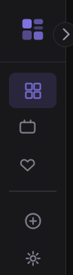

# Omniview

A personal design reference tool for collecting and browsing inspiring web and mobile designs.



## What it does

Omniview centralizes your scattered design inspiration into one searchable local library. Screenshot a website or mobile app you love, add it to your collection with metadata and style tags, then browse and filter your growing library whenever you need design references.

## Features

- **Capture & Store**: Paste a URL and Omniview fills in the title, `og:image`, favicon, and color for you. Paste or drop screenshots anywhere in the window; keep several per entry.
- **Tag by Style**: Organize designs by visual style, pattern, or aesthetic; merge and bulk-delete tags in Settings
- **Browse & Search**: Gallery, masonry, or list layout; filter by type, tag, board, favorite, or dominant color swatch
- **Project Boards**: Group designs into project-specific boards; drag a card onto another board to add it
- **Duplicate detection**: Saving a page you already have (ignoring `www.`, `http`/`https`, trailing slashes, and tracking parameters) offers "Open it" or "Add anyway"
- **Local Only**: Everything runs on your machine—no cloud, no accounts, no sharing. The only outgoing requests are the page fetches you trigger by entering a URL.

## Getting Started

1. Clone the repo and install dependencies:
   ```bash
   npm install
   ```

2. Start the server:
   ```bash
   npm start
   ```

3. Open `http://localhost:3737` in your browser

Press `?` in the app for the keyboard shortcuts.

## How it works

- **Frontend**: Browser-based interface (plain ES modules in `public/js/`, no build step)
- **Backend**: Express 5 server with file upload and storage; thumbnails and color palettes via [sharp](https://sharp.pixelplumbing.com/)
- **Database**: Local JSON library (`db/library.json`), kept in memory and saved with a short debounce. The first write of each day also saves a copy to `db/backups/` (last 7 kept).

## Project Structure

```
├── public/           # Frontend
│   ├── index.html
│   ├── styles.css
│   └── js/           # ES modules: main (boot, nav, shortcuts), state, api, browse,
│                     #   entry (add form + detail), boards, options, settings, modals
├── db/               # library.json (+ backups/)
├── uploads/          # Screenshots (+ thumbs/, generated)
├── test/             # API tests (npm test)
├── docs/             # README images
└── server.js         # Express server
```

## Configuration

| Variable | Default | Purpose |
| --- | --- | --- |
| `PORT` | `3737` | Port to listen on (always bound to `127.0.0.1`) |
| `OMNIVIEW_DB_PATH` | `db/library.json` | Library file |
| `OMNIVIEW_UPLOADS_DIR` | `uploads/` | Screenshot folder |

## API

JSON over HTTP on the same origin. Every non-`GET` request must send `X-Omniview: 1`, and the `Host`/`Origin` must be local; this stops other websites from calling the API through your browser.

| Endpoint | Purpose |
| --- | --- |
| `GET /api/entries`, `GET /api/entries/:id` | List (newest first) / fetch |
| `POST /api/entries` | Create; `409` with the existing entry if the URL is already saved, unless `force: true` |
| `PUT /api/entries/:id`, `DELETE /api/entries/:id` | Update / delete |
| `POST /api/entries/bulk` | `{ids, action}`: `tag`, `untag`, `setType`, `addToBoard`, `removeFromBoard`, `favorite`, `delete` |
| `POST /api/entries/:id/screenshot` | Upload a screenshot (multipart field `screenshot`; max 10 per entry) |
| `POST /api/entries/:id/screenshot-url` | Download an image URL as a screenshot |
| `DELETE /api/entries/:id/screenshots/:file` | Remove one screenshot |
| `GET /api/unfurl?url=` | Title, `og:image`, favicon, and theme color of a page |
| `GET /api/duplicate?url=` | Is this URL already saved? |
| `/api/boards`, `/api/tags`, `/api/types`, `/api/found-via` | Managed lists (create, rename, delete) |
| `POST /api/tags/merge`, `POST /api/tags/bulk-delete` | Merge or delete several tags |
| `GET /api/export?format=json\|zip` | Export the library (ZIP includes screenshots) |
| `POST /api/cleanup` | Delete upload files no entry references |
| `POST /api/reset` | Wipe everything; requires `{"confirm":"reset"}` |

## Single-User Design

Omniview is built for one person on one machine. No multi-user features, no authentication, no deployment—just a personal tool that runs when you need it.

---

Built with Node.js & Express
